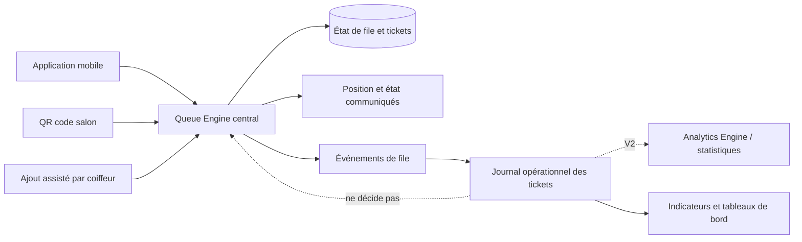

# FILA — Product Bible

Version 0.2 — mise à jour 22 octobre 2026  
Statut : **RÉDIGÉ — À VÉRIFIER**. Les décisions de base ci-dessous sont celles explicitement posées par le fondateur dans la mission principale du 17 octobre (SRC-001). Ce statut ne vaut pas validation de ce document dans son ensemble. L’historique intégral antérieur reste à reconstituer.

## 1. Résumé du produit

FILA est un service numérique destiné à aider les salons de coiffure et barbershops en Côte d’Ivoire à organiser les files d’attente par coiffeur. Il doit permettre à un client de demander une place, connaître sa position et suivre l’attente, tout en donnant au coiffeur une interface rapide pour gérer la file et assister les personnes qui n’utilisent pas de smartphone.

Le besoin évoqué est particulièrement visible lors de périodes de forte affluence, notamment autour de fêtes musulmanes et chrétiennes, et dans des zones densément peuplées telles que Yopougon et Abobo. Cette description est le contexte de conception du fondateur; elle ne constitue pas encore une étude de marché ni une mesure de la demande.

FILA combine une application mobile Android/iOS et des parcours d’entrée par QR code ou ajout manuel du client par le coiffeur. Tous les canaux s’appuient sur un Queue Engine central. En V1, FILA conserve seulement les événements opérationnels nécessaires aux tickets; l’Analytics Engine, les statistiques et tableaux de bord sont reportés à V2 et ne décident jamais de l’ordre. Le MVP se concentre sur une file fiable et accessible; les offres payantes de priorité sont reportées à la version 2.

## 2. Vision, mission et problème

### Vision

Rendre l’attente dans les salons de coiffure plus compréhensible et mieux organisée, sans rendre l’accès au service dépendant du smartphone du client ni ralentir le travail du coiffeur.

### Mission produit

Fournir aux salons un moyen simple et fiable d’enregistrer les clients, d’ordonner les passages par coiffeur, de communiquer une position utile et de gérer les changements de statut et les entrées assistées.

### Problème à résoudre

Le fondateur décrit de longues attentes dans les salons et barbershops pendant les périodes de forte affluence. Aujourd’hui, les alternatives possibles — attente sur place, liste orale ou papier, appels et messages — doivent être documentées et comparées sur le terrain. FILA doit clarifier qui attend, auprès de quel coiffeur, quelle est la progression, et permettre au personnel de corriger les situations courantes.

### Opportunité et limites de preuve

La présence d’un problème est une hypothèse de produit portée par le fondateur. Le nombre de salons concernés, les habitudes d’attente, la disposition à utiliser le téléphone, la volonté de payer, les volumes d’attente et les solutions concurrentes ne sont pas établis par les sources actuellement disponibles. Aucune statistique de marché, enquête, traction ou client pilote n’est revendiqué ici.

## 3. Utilisateurs et parties prenantes

| Groupe | Besoin supposé / rôle dans le service | État de preuve |
|---|---|---|
| Client avec smartphone | Rejoindre une file, choisir ou demander un coiffeur disponible, comprendre sa position et l’évolution de l’attente. | Besoin de conception; à tester. |
| Client sans smartphone ou enfant | Accéder au service sans compte ou appareil personnel, avec une assistance appropriée. | Exigence d’inclusion confirmée; parcours détaillé à définir. |
| Coiffeur | Voir sa file, enregistrer ou assister un client, faire avancer les statuts rapidement et corriger une erreur permise. | Exigence confirmée; tests en situation nécessaires. |
| Responsable de salon | Installer/administrer le salon et éventuellement consulter les indicateurs. | Partie prenante présumée; responsabilités et nécessité d’un rôle distinct non établies. |
| Fondateur / opérateur FILA | Définir l’offre, suivre la qualité, les coûts et l’adoption. | Partie prenante projet. |

Les personas qui seront produits en recherche doivent porter la mention « provisoire » tant qu’ils ne dérivent pas d’entretiens documentés.

## 4. Proposition de valeur

- **Pour les clients :** réduire l’incertitude sur leur place et l’attente, avec une voie d’accès assistée pour les personnes qui ne disposent pas d’un smartphone.
- **Pour les coiffeurs :** centraliser les entrées d’une file par coiffeur avec des actions simples, afin de limiter les oublis, les doublons et les disputes de passage.
- **Pour les salons :** améliorer l’organisation de la file en V1; les statistiques et tableaux de bord ne sont prévus qu’en V2.

Ces propositions sont des objectifs de conception, pas des résultats démontrés. Le bénéfice doit être évalué par des tests d’usage et un pilote.

## 5. Principes produit

1. **Une seule source de vérité pour la file.** Toute entrée et toute transition passent par le Queue Engine central.
2. **Accès inclusif.** L’accès assisté est disponible dans l’espace coiffeur; le produit ne dépend pas d’un gérant distinct.
3. **Actions rapides côté coiffeur.** Réduire le nombre de manipulations et le texte à saisir; la rapidité sera mesurée en test.
4. **Règles explicables.** Affectation, priorité, annulation et absence sont explicites et vérifiables.
5. **Données minimales.** Le nom peut être un pseudonyme, le service est facultatif et le numéro du ticket est généré par le système.
6. **Ordre transparent.** Les événements opérationnels V1 n’influencent jamais le rang. Analytics Engine séparé et reporting sont réservés à V2.
7. **Fiabilité avant prix minimal.** Les services choisis doivent satisfaire les besoins de cohérence, de sécurité et de reprise, avec leurs coûts documentés.
8. **Pas de promesse non prouvée.** Les attentes affichées sont des estimations si elles le sont; les performances, économies et revenus ne sont pas promis sans données.

## 6. Périmètre MVP

### Inclus comme objectifs de capacité

- Prise en charge des plateformes Android et iOS dès le lancement.
- Création et suivi d’un ticket de file organisé par coiffeur.
- Choix d’un coiffeur précis ou demande du premier coiffeur disponible.
- Entrée via application, QR code, ou ajout manuel par le coiffeur.
- Queue Engine central qui évite les doublons, positions conflictuelles et incohérences entre canaux.
- Un ticket actif maximum par utilisateur, avec blocage/résolution d’un ticket déjà actif avant une nouvelle inscription.
- Gestion des changements d’état nécessaires : annulation, absence, prestation terminée et correction d’erreur selon règles définies.
- Profil initial renseigné une seule fois; nom pseudonyme permis; type de prestation facultatif; numéro de ticket système.
- Espace coiffeur permettant l’assistance à l’accès et des gestes de gestion rapides.
- Journal opérationnel minimal du ticket en V1; analytics, statistiques et tableaux de bord seulement en V2.
- Conception tenant compte d’une connectivité parfois limitée; comportement hors réseau à spécifier et tester.

### Exclusions et reports

- Voie rapide payante ou offre prioritaire : reportée à V2, exclue des règles de passage du MVP.
- Développement de l’application complète avant la documentation de référence et les règles vérifiées.
- Toute promesse d’intégration ou de service tiers non évalué.
- Toute fonction qui augmente les données collectées ou la complexité sans bénéfice démontré.

La V1 inclut OTP à la première inscription app/QR, notifications ticket limitées, parcours navigateur QR et écritures en ligne seulement. Les règles détaillées sont dans le SRS v0.2.

## 7. Fonctionnement conceptuel

1. Le client entre dans le parcours mobile, scanne le QR du salon ou demande une aide au coiffeur.
2. Le système identifie le salon et le contexte de file, puis demande les informations minimales requises.
3. Le client sélectionne un coiffeur ou demande une affectation au premier disponible. Le système vérifie son ticket actif et la disponibilité.
4. Le Queue Engine attribue et enregistre le ticket de façon atomique, produit un numéro et une position cohérente, et conserve le canal d’origine.
5. Le client consulte l’état disponible; le coiffeur fait avancer la file par des actions autorisées.
6. Les événements opérationnels indispensables (création, appel, absence, réactivation, fin, annulation, expiration) sont conservés pour gérer le ticket; ils ne produisent pas de statistiques en V1.

Ce flux est fonctionnellement confirmé à haut niveau. Les étapes précises, erreurs, transitions, identifiants et interactions doivent être spécifiés avant implémentation.

## 8. Règles et contraintes structurantes

- L’unité de file est le coiffeur au sein d’un salon.
- Un compte avec numéro vérifié est reconnu entre salons; une fiche sans compte est limitée au salon et ne garantit pas l’unicité inter-salon.
- Le numéro de ticket est attribué par FILA, jamais saisi comme donnée personnelle.
- Le Queue Engine assure une seule position logique malgré les demandes simultanées de plusieurs canaux.
- Les statistiques n’influent pas sur l’ordre de passage.
- Les vitesses et spécialités peuvent être prises en compte dans la conception, mais leur usage exact (estimation, recommandation ou éligibilité) reste ouvert.
- Les horaires affichés sont informatifs; chaque coiffeur ferme manuellement sa propre file. Absence, expiration, réactivation et changement de coiffeur suivent RM-037..042.
- Le parcours QR est servi et validé côté serveur; l’association au salon et éventuellement au coiffeur reste à arrêter.

## 9. Objectifs et indicateurs de réussite à instrumenter

Les indicateurs suivants sont des propositions de mesure, pas des cibles chiffrées déjà approuvées :

| Dimension | Indicateur | Définition à stabiliser |
|---|---|---|
| Adoption salon | Salons activés et actifs | Définir activation, activité et période. |
| Adoption client | Tickets créés par canal | Dénominateur, doublons et annulations à traiter. |
| Fiabilité | Échecs, conflits et doublons empêchés | Journaliser les tentatives et distinguer erreur d’usage/technique. |
| Expérience client | Compréhension de la position et réussite du parcours | Mesure par test et enquête; pas de score initial disponible. |
| Rapidité coiffeur | Temps et nombre de gestes pour ajouter ou faire avancer un ticket | Mesurer sur tâches réalistes, avec interruptions. |
| Qualité opérationnelle | Attente, durée de prestation, absences, annulations | Formules et périmètre temporel à définir; préciser données manquantes. |
| Résilience | Succès de reprise après perte de réseau/erreur | Scénarios et seuils à définir dans le plan de tests. |

Aucun objectif numérique n’est fixé sans données terrain et capacité de mesure.

## 10. Analytique

À partir de V2, les indicateurs demandés sont : nombre de clients servis, temps moyen d’attente, durée moyenne de prestation, absences, annulations, coiffeurs les plus sollicités, heures de pointe et origine des entrées. Il faudra définir précisément les événements source, les horodatages, fuseaux, exclusions, traitements des annulations et statistiques en cas d’absence d’une heure de début ou fin.

En V1, aucun Analytics Engine, calcul statistique ou tableau de bord n’est livré. Le journal opérationnel ticket ne modifie jamais l’ordre. En V2, le moteur analytique devra être découplé du Queue Engine et minimiser les données personnelles.

## 11. Contraintes locales et accessibilité

Le produit doit prendre en compte l’accès inégal aux smartphones, l’usage par des enfants, la simplicité des pratiques locales, les différences entre salons, les pics de demande et une connectivité parfois limitée. Ces contraintes sont des exigences de conception décrites par le fondateur; leur fréquence et leur forme concrète devront être vérifiées auprès de clients et coiffeurs à Yopougon, Abobo et autres sites choisis.

Principes à tester : lisibilité sur petits écrans; faible saisie; langage courant; confirmation claire des actions; parcours assisté ne révélant pas plus de données que nécessaire; état de file horodaté si connexion interrompue; explication visible lorsque les données ne sont pas à jour. La localisation linguistique et les besoins d’accessibilité spécifiques restent à rechercher.

## 12. Hypothèses, risques et mesures

| Hypothèse/risque | Conséquence si fausse | Moyen de vérification |
|---|---|---|
| Les salons veulent formaliser leur file par coiffeur. | Faible adoption, contournement du système. | Observation et entretiens de salons variés. |
| Les clients veulent connaître une position même si l’estimation temporelle est imprécise. | Fonction principale peu utile ou génératrice de défiance. | Tests comparant position, fourchette et absence d’estimation. |
| Le coiffeur peut saisir un client sans ralentir la prestation. | Files tenues hors système, données incomplètes. | Test contextualisé et mesure du temps/erreurs. |
| Une identité client légère peut garantir l’unicité sans exclure les sans-smartphone. | Doublons ou collecte excessive. | Prototypes et revue de confidentialité. |
| Le QR est une entrée fiable en salon. | URL partagée, imprimé obsolète, mauvais salon. | Test révocation/rotation et pilote. |
| La connectivité permet la confirmation serveur de chaque écriture. | Blocage ou état divergent pendant incident réseau. | Mesure terrain et tests de panne/reprise. |
| Supabase/PostgreSQL et React Native/Expo conviennent au produit. | Risque de limites de plateforme, dépendance ou opérations difficiles. | ADR, prototype technique et revue des offres/documentations actuelles. |

## 13. Évolutions futures

- V2 : étudier une voie rapide ou offre prioritaire payante, sans l’inclure dans le MVP; toute mise en œuvre devra être explicitement arbitrée et rester compréhensible et équitable.
- Améliorations potentielles à évaluer : statistiques avancées, mécanismes de notification, recommandations fondées sur disponibilités/spécialités, outils de gestion multi-salons. Ces points ne sont pas des engagements de roadmap.

## 14. Questions de conception à résoudre

Voir les Q-001 à Q-012 dans `../00-index-et-etat-du-projet/DECISIONS.md`. Priorités avant spécification détaillée : identité/unicité du ticket, algorithme premier disponible, résolution d’un ticket ailleurs, transitions absence/annulation, QR, rôles et fonctionnement avec réseau faible.

## 15. Glossaire

| Terme | Définition de travail |
|---|---|
| Salon | Établissement où un ou plusieurs coiffeurs proposent des prestations. |
| Coiffeur | Personne dont la file de clients est gérée; peut aussi tenir le salon. |
| File | Ordre de tickets associé à un coiffeur dans un salon. |
| Ticket | Enregistrement système d’une demande de place, avec identifiant/numéro généré et état. |
| Ticket actif | Ticket qui n’a pas atteint un état terminal défini; les états exacts restent à valider. |
| Queue Engine | Composant central qui valide les entrées et transitions, et maintient l’état cohérent de la file. |
| Analytics Engine | Composant de V2 séparé du Queue Engine; calcule des indicateurs sans décider de l’ordre. |
| Ajout assisté | Création ou accompagnement d’un ticket par le coiffeur pour un client qui n’utilise pas directement l’application. |
| Premier disponible | Option d’affectation demandée par le client; algorithme et critères non encore spécifiés. |
| Canal d’entrée | Application mobile, QR code ou ajout manuel par le coiffeur. |
| MVP | Première version centrée sur une file fiable et utilisable; critères de sortie à formaliser. |

## 16. Historique et références

- **17-10-2026 — v0.1 :** première Product Bible dérivée de la mission principale du fondateur; règles explicites inscrites au registre D-001 à D-022. Questions non tranchées maintenues comme ouvertes.
- **15-10-2026 — audits antérieurs :** état documentaire incomplet et archives ChatGPT non intégrales; voir SRC-003/004 dans l’index et `HISTORIQUE_A_RECONSTITUER.md`.
- Aucune archive intégrale FILA n’a été consultée. Une mise à jour historique est requise à sa réception.

## 17. Décisions opérationnelles intégrées le 22 octobre 2026

Les précisions ci-dessous issues de SRC-008 font partie du cadrage V1 et remplacent les formulations antérieures incompatibles :

- **Identité :** compte avec numéro vérifié = reconnaissance inter-salon; sans compte ou avec fiche assistée = profil limité au salon; le salon peut créer une fiche minimale sans téléphone. OTP à la première inscription dans l’app ou le navigateur QR; session valide réutilisée sans nouveau code. Sans numéro utilisable, accès assisté.
- **Affectation :** choix précis respecté sans transfert silencieux. « Premier disponible » = coiffeurs acceptant les tickets et aptes au service, minimum de clients devant; égalité au plus long depuis la dernière attribution. Vitesse estimée uniquement pour l’attente, sans effet sur l’ordre et sans promesse.
- **QR :** QR salon ouvrant le parcours navigateur sans installation.
- **Ticket dans un autre salon :** proposer conservation ou annulation pour rejoindre; le nouveau ticket doit être créé avec succès avant d’annuler l’ancien. En cas d’échec, l’ancien reste actif.
- **Absence et fermeture :** absence manuelle par le coiffeur après appel. Les horaires sont informatifs, sans fermeture automatique. Chaque coiffeur ferme sa file manuellement. À cette fermeture, tickets non servis expirent; les prestations commencées se terminent. Les autres files restent ouvertes. File fermée : choix explicite d’un autre coiffeur ou retour plus tard.
- **Réactivation :** même jour, avant fermeture, par le coiffeur responsable. Son action lance les contrôles; succès = réactivation sans seconde confirmation. Il juge la justification; si acceptée, le ticket reprend son rang initial. Journaliser action/auteur sans détail sensible. Pas de réactivation le lendemain; nouveau ticket requis.
- **Changement de coiffeur :** avant appel, fin de la file du nouveau coiffeur; après appel, demande au coiffeur et action explicite de celui-ci.
- **Mineurs :** aucun compte enfant, numéro ou date de naissance; profil d’affichage géré par l’adulte. Profil assisté salon-only si l’adulte n’a pas de compte.
- **V1 sans analytics :** événements opérationnels des tickets seulement. Analytics Engine, statistiques et tableaux de bord en V2. Notifications V1 limitées à création confirmée, approche du tour, appel, annulation et expiration. Le client ne paie pas pour prendre/suivre son ticket; tarif salon à définir.
- **Connexion :** toute écriture exige Internet et confirmation serveur. Hors ligne, montrer l’ancienneté et interdire l’écriture; à la reconnexion, synchroniser l’affichage. Une panne individuelle ne bloque pas les autres en ligne. Pas de synchronisation d’écriture hors ligne.
- **Historique :** terminés/annulés/expirés retirés de la liste active. Historique client 30 jours et salon 90 jours, chargé à la demande et paginé; suppression/anonymisation après la durée sous réserve de validation juridique avant essais réels/lancement.

Les règles complètes sont dans `../04-regles-metier/REGLES_METIER.md` (RM-031..048), exigences dans `../03-srs-cahier-des-charges/SRS_FILA.md` (FR-029..050). Les contraintes juridiques et faisabilité fournisseur ne sont pas réputées validées.

