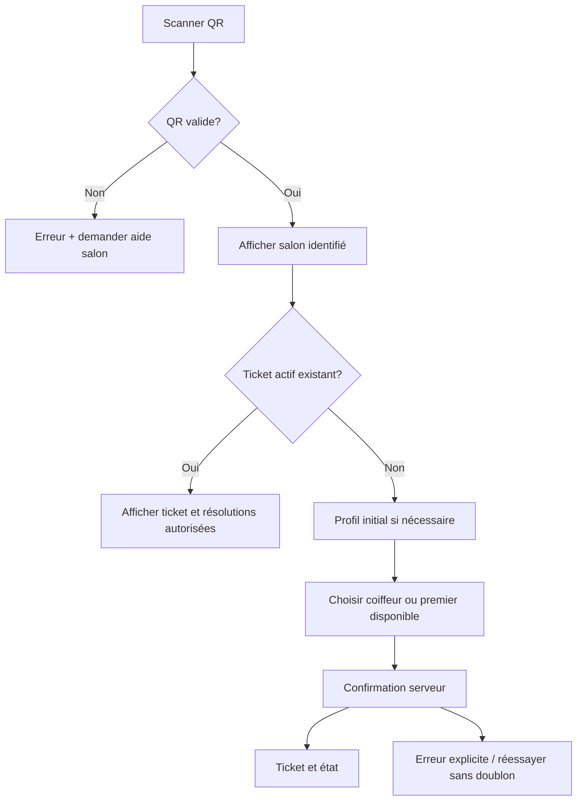
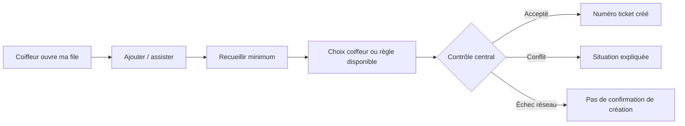

# FILA — Spécifications UX/UI et préparation Figma

Version 0.2 — mise à jour 22 octobre 2026 — **RÉDIGÉ — À VÉRIFIER**. Spécifications de conception textuelles; aucun fichier ni prototype Figma n’a été créé.

## 1. Principes d’expérience

- Distinguer immédiatement client, coiffeur et responsable; ne demander aucune permission ou donnée avant son utilité.
- Prioriser les tâches fréquentes et réduire la saisie dans l’espace coiffeur.
- Montrer l’état et la dernière mise à jour; distinguer position, estimation et promesse.
- Confirmer les actions qui retirent un client de la file ou affectent son tour; offrir correction contrôlée.
- Permettre un parcours assisté pour une personne sans smartphone et éviter le compte enfant par défaut.
- Signaler les états indisponibles et erreurs en langage simple avec action suivante.

## 2. Architecture de l’information

```text
FILA
├── Entrée client
│   ├── Choisir/scanner le salon
│   ├── Créer ou reprendre un profil client
│   ├── Choisir un coiffeur / demander premier disponible
│   └── Mon ticket et état de file
├── Espace coiffeur
│   ├── Sélection salon/coiffeur autorisé
│   ├── Ma file et prochain client
│   ├── Ajouter / assister un client
│   ├── Actions ticket et correction contrôlée
│   └── Disponibilité / pause (règle à définir)
└── Gestion salon (si rôle retenu)
    ├── Profil et coiffeurs
    ├── QR code et accès
    └── Analytique agrégée
```

## 3. Inventaire d’écrans candidat

### Client
1. Démarrage et choix de parcours.
2. Scan QR / saisie ou sélection salon.
3. Profil initial minimal (pseudonyme; prestation facultative).
4. Sélection du coiffeur ou premier disponible.
5. Résolution ticket actif existant.
6. Confirmation et ticket créé.
7. Vue ticket : salon, coiffeur, position/état, fraîcheur de mise à jour, action de retrait si autorisée.
8. Erreur de connexion, file indisponible, QR invalide.

### Coiffeur
1. Connexion et choix du salon/file autorisée.
2. Tableau « ma file » avec prochain ticket et actions principales.
3. Ajout/assistance client minimal.
4. Choix coiffeur ou premier disponible si pertinent.
5. Détail ticket et actions d’appel, début/fin, absence ou annulation selon transitions validées.
6. Confirmation/correction d’action.
7. État connexion dégradée et reprise.

### Responsable, si validé
1. Gestion salon et membres.
2. Génération/rotation/révocation QR.
3. Consultation analytics agrégée.

L’existence d’un rôle distinct de responsable est à confirmer; aucun écran correspondant ne doit devenir prérequis pour l’accès assisté.

## 4. Flux principaux

### Client QR



### Ajout assisté



### Coiffeur fait avancer la file

Sélection d’un seul ticket → affichage statut actuel → action disponible selon rôle/état → confirmation si action destructive → résultat serveur → mise à jour de la liste. L’écran doit préserver le contexte si l’utilisateur touche le mauvais contrôle; action de correction dépend d’une règle auditée.

## 5. Wireframes basse fidélité (structure, non visuels)

### File coiffeur

```text
┌────────────────────────────────┐
│ [Salon]  [Coiffeur]     Réseau ●│
│ Ma file · 8 tickets             │
│                                │
│ PROCHAIN                         │
│ Ticket 024 · Alex               │
│ Prestation : —                  │
│ [Appeler]                       │
│                                │
│ En attente                      │
│ 025 · Sam       2e              │
│ 026 · Client assisté  3e        │
│ ...                            │
│                                │
│ [ + Ajouter / assister ]        │
│ [Pause / disponibilité]*        │
└────────────────────────────────┘
*Action et règle à valider. Les informations de maquette sont fictives.
```

### Ticket client

```text
┌────────────────────────────┐
│ Salon : exemple            │
│ Coiffeur : exemple         │
│                            │
│ Votre ticket 024           │
│ Position : 3e              │
│ État mis à jour à 14:32    │
│ Temps estimé : non affiché │
│                            │
│ [Besoin d’aide?]           │
│ [Annuler ma place]*        │
└────────────────────────────┘
*Afficher seulement si autorisé.
```

## 6. États des composants

- Chargement : squelette ou indicateur avec action non répétable; empêcher double soumission.
- Vide : expliquer comment obtenir le premier ticket ou ajouter une personne.
- Erreur validation : champ précis, correction directe.
- Erreur de service : distinguer ticket non créé de résultat inconnu; bouton de reprise doit être idempotent.
- Hors connexion : bannière visible « dernières informations reçues à … », pas de faux état temps réel.
- Succès : confirmation du serveur, numéro ticket et prochain geste.
- Conflit actif : montrer le ticket existant avec action résolutive autorisée, sans créer le second.
- Coiffeur indisponible/file fermée : expliquer le choix nécessaire; jamais réaffecter silencieusement.

## 7. Design system initial

- Grille mobile à une colonne pour tâches principales; zones tactiles généreuses et espacées.
- Typographie lisible; ne pas dépendre uniquement de la couleur pour statut/alerte.
- Un bouton primaire unique par vue de travail coiffeur; actions destructives séparées et confirmées.
- Palette sémantique à définir après essai contraste; chaque statut associe libellé, icône et couleur.
- Composants : `QueueTicketCard`, `QueuePosition`, `StatusBadge`, `ConnectionBanner`, `BarberAvailability`, `ClientEntryMethod`, `ConfirmAction`, `EmptyQueue`, `InlineError`.
- Utiliser tokens documentés pour espace, tailles, typographie, rayon et états; éviter choix de marque définitifs sans préférence du fondateur.

## 8. Accessibilité et localisation

- Contraste vérifié, texte redimensionnable, lecteur d’écran et ordre de focus contrôlés.
- Libellés explicites et messages non fondés sur couleur seule.
- Favoriser vocabulaire courant et phrases courtes; tester le français utilisé sur place et identifier les besoins linguistiques via recherche.
- Tolérer nom/pseudonyme court; prévoir usage par téléphone partagé et assistance humaine.
- Vérifier lisibilité en lumière forte, petits écrans et gestes à une main.
- Aucun parcours numérique exclusif; coiffeur peut faire l’ajout assisté dans son espace.
- Pour les enfants, favoriser une démarche de l’accompagnant; collecte et visibilité à définir.

## 9. Prototype Figma — prochaine étape

Créer les frames mobile client (QR et ticket), espace coiffeur (file et ajout assisté), erreurs réseau et conflit ticket existant. Prototyper données fictives et états; vérifier d’abord les tâches avec coiffeurs/clients, puis construire un système visuel cohérent. Figma n’a pas été accessible/édité dans cette phase; les présents wireframes sont textuels.

## 10. Mise à jour des parcours V1 — 22 octobre 2026

Ces règles issues de SRC-008 / D-023..D-037 remplacent les variantes plus anciennes ci-dessus lorsqu’elles divergent.

### Parcours identité et QR

- Le QR associe le salon et ouvre le navigateur; aucune installation d’app n’est nécessaire. Le client confirme le salon, puis choisit coiffeur ou « premier disponible ».
- À la première inscription par app ou navigateur, un numéro utilisable est vérifié par code à usage unique. Aux visites suivantes, session valide sans nouveau code. Si aucun numéro utilisable ou compte, proposer au coiffeur un profil minimal propre au salon.
- Un adulte peut gérer un profil d’affichage enfant sans compte enfant et sans numéro/date de naissance de l’enfant.
- Le compte vérifié permet la reconnaissance inter-salon. La fiche assistée reste salon-only; l’écran ne doit pas laisser croire qu’un ticket ailleurs a été détecté.
- Si un compte a un ticket actif ailleurs, choix clair : conserver le ticket existant ou l’annuler pour rejoindre cette file. Montrer que l’ancien ne sera annulé qu’après création confirmée du nouveau; en cas d’échec, le ticket existant reste actif.

### Affectation

Afficher la liste des coiffeurs qui acceptent les tickets et peuvent réaliser le service, puis « premier disponible ». Le choix précis ne change pas silencieusement. Pour « premier disponible », afficher le coiffeur retenu selon charge de clients devant et règle d’égalité de dernière attribution. Une estimation de temps est marquée comme estimation, jamais promesse et ne modifie pas le rang.

Si la file choisie est fermée : indiquer clairement son statut et offrir choix explicite d’une autre file ouverte ou retour plus tard. Avant appel, demande de changement place à la fin de la file du nouveau coiffeur. Après appel, la demande est adressée au coiffeur; montrer une confirmation de son action, pas de transfert automatique.

### Interface coiffeur : états de file

- Horaires visibles = information; aucun changement automatique d’état à l’heure prévue.
- Un coiffeur ferme sa propre file manuellement, indépendamment des autres.
- Après appel, l’action « absent » est manuelle; aucun compte à rebours ne marque le client absent.
- Réactivation : action du coiffeur responsable même jour, avant fermeture; les contrôles se lancent immédiatement. En cas de réussite, l’action se termine sans deuxième confirmation et explique le résultat. Le responsable juge la justification; si acceptée, le ticket retourne à sa place originale. Pas de motif sensible obligatoire.
- À fermeture effective, les tickets non servis, absents ou appelés sans prestation commencée expirent; le service en cours se poursuit. L’expiration d’hier ne propose pas de réactivation; le client doit reprendre un ticket.

### Connexion, historique et notifications

Hors connexion, afficher bandeau visible avec heure de dernière actualisation; désactiver création/modification et expliquer qu’Internet est requis. Reconnexion = actualiser état du serveur; panne serveur = message d’échec, sans ticket fantôme. La panne isolée d’un client ne doit pas bloquer le parcours des autres qui atteignent le serveur.

L’historique n’est pas chargé au démarrage : accès à la demande, pages limitées; vue client 30 jours et salon 90 jours selon cadrage à valider juridiquement avant essais réels/lancement. Notifications V1 : ticket créé, approche du tour, appel, annulation et expiration seulement. L’accès à un ticket est gratuit côté client; ne pas afficher de paiement client.

## 11. Liste de contrôle du prototype

Scénarios à prototyper : numéro OTP première inscription, retour session valide, QR sans application, profil assisté salon-only sans téléphone, profil enfant géré par adulte, conflit ticket actif global et transaction échec/succès, choix de coiffeur fermé, changement avant/après appel, absence manuelle après appel, fermeture manuelle avec prestation en cours, réactivation à rang d’origine, affichage hors ligne puis resynchronisation, historique paginé. Aucun prototype ni test utilisateur n’a été réalisé.

