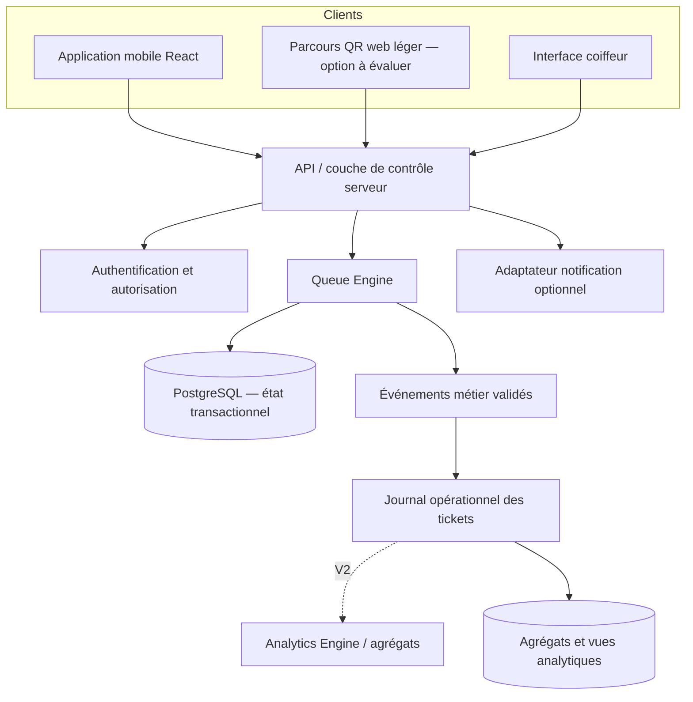
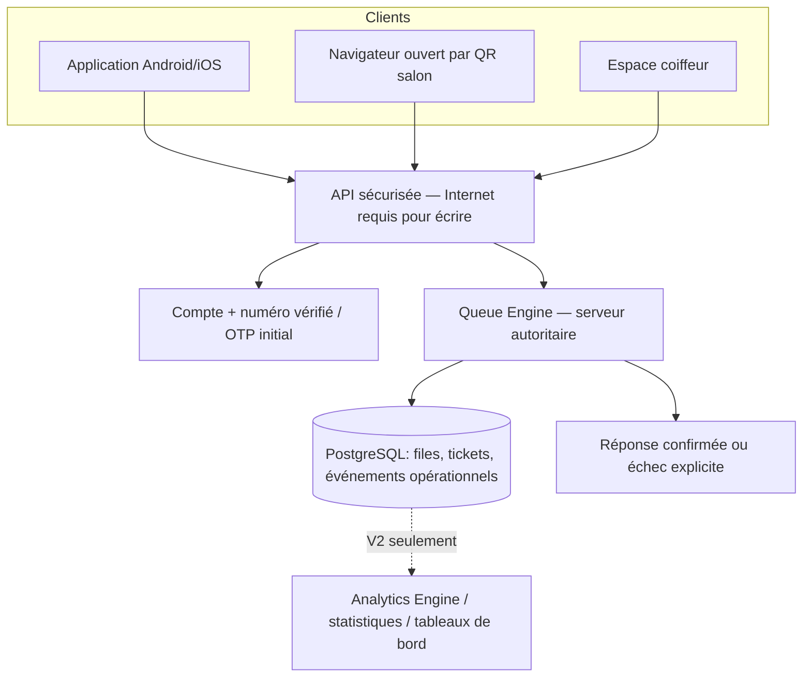

# FILA — Spécifications techniques et architecture

Version 0.2 — mise à jour 22 octobre 2026 — **RÉDIGÉ — À VÉRIFIER**. L’orientation React / solution mobile, Supabase et PostgreSQL est validée comme base d’étude, pas comme choix final de tous les services (D-019 à D-022). Les propositions ci-dessous sont des recommandations architecturales à éprouver.

## 1. Objectifs et contraintes

- Android et iOS dès le lancement; compétences de départ du fondateur en HTML, CSS, JavaScript et React.
- Transactions de file cohérentes entre application, QR et ajout assisté.
- Une seule identité/règle effective de ticket actif par utilisateur.
- Analytics découplé et sans influence sur l’ordre.
- Fiabilité et sécurité avant coût minimal; exploitation maintenable par un fondateur débutant en mobile professionnel.

## 2. Architecture logique proposée

Ce schéma est logique, pas un déploiement déjà choisi. Les opérations d’écriture critiques ne doivent pas être exécutées directement par un client qui pourrait falsifier l’ordre. Avec Supabase, une frontière serveur (par exemple fonctions contrôlées ou procédure transactionnelle en base) doit centraliser création et transitions, protéger par autorisations et contraintes et être testée en concurrence.

## 3. Responsabilités

- **Application mobile :** parcours client et coiffeur, état local de présentation, validation de formulaire non autoritaire, affichage clair du statut et de sa fraîcheur.
- **Parcours web QR :** entrée rapide sans installation; sa présence et son périmètre au MVP restent à évaluer. Il appelle la même API et ne détient aucun droit privilégié.
- **API / couche serveur :** authentifier, autoriser par salon, appliquer règles et appeler les transactions du Queue Engine; fournir des réponses idempotentes et observables.
- **Queue Engine :** attribuer, ordonner et faire évoluer les tickets dans des transactions cohérentes; appliquer l’unicité active et journaliser les événements.
- **PostgreSQL :** stockage transactionnel, contraintes d’intégrité, clés étrangères, index et séparation des données. Le schéma final doit être dérivé des décisions d’identité et de rôles.
- **Journal opérationnel V1 :** enregistrer les événements requis pour l’état et l’historique des tickets. Les agrégats et tableaux de bord appartiennent à Analytics Engine en V2.
- **Adaptateur notifications :** composant optionnel; échec de notification ne modifie pas le ticket. Choix du canal/prestataire dépend d’une vérification de couverture, prix, délais et consentement.

## 4. Choix technologiques à instruire

| Domaine | Base/favori exprimé | Évaluation nécessaire | Recommandation de travail |
|---|---|---|---|
| Mobile | React; Android/iOS | Comparer React Native avec Expo, stratégie native nécessaire, modules QR/notifications, builds et publication | Prototyper parcours critique et tester builds réels avant verrouillage. |
| Backend/base | Supabase/PostgreSQL envisagés | Limites de plan, région, coûts, auth, fonctions serveur, sauvegarde/restauration, capacité et support | Utiliser PostgreSQL avec invariants côté serveur; garder le domaine métier indépendant du fournisseur. |
| QR | Génération serveur confirmée | jeton, révocation, salon/coiffeur, URL exposée, abus et rotation | QR public opaque, sans donnée personnelle ni privilège, révocable; confirmer modèle. |
| Auth | Non arrêté | compte client obligatoire ou parcours léger, OTP et coûts, clients assistés, récupération | Décider après prototype et analyse du risque d’identité unique. |
| Notifications | Non arrêté | SMS/push, couverture locale, coûts, délivrabilité, consentement, modes échec | Ne jamais utiliser notification comme preuve de création; maintenir consultation du ticket. |
| Déploiement | Non arrêté | environnements, secrets, migrations, boutiques, sauvegardes, restauration | Séparer dev/test/prod, revue de migration et procédure de rollback documentée. |

Cette section n’affirme aucune capacité/prix actuelle d’un fournisseur; ces éléments doivent être vérifiés sur la documentation officielle et les offres en vigueur avant décision.

## 5. Contrat d’API conceptuel

Les noms sont indicatifs; aucun contrat final ne doit être implémenté avant arbitrage métier.

| Opération | Entrée indicative | Résultat / invariants |
|---|---|---|
| `POST /queue-tickets` | salon, choix coiffeur ou `first_available`, source, demande idempotente, référence client autorisée | ticket unique ou conflit avec ticket actif; rang et numéro décidés côté serveur. |
| `GET /queue-tickets/{id}` | identifiant ticket et preuve d’accès | statut/position visible au titulaire ou rôle salon autorisé; pas de fuite inter-salon. |
| `POST /queue-tickets/{id}/transition` | action, version/état attendu, clé idempotente | transition autorisée ou conflit explicite; acteur et heure journalisés. |
| `POST /salons/{id}/qr` | action salon autorisée | QR public opaque créé/renouvelé/révoqué selon politique. |
| `GET /salons/{id}/analytics` | fenêtre de temps et filtres autorisés | agrégats sans commande sur Queue Engine. |

Codes d’erreur minimaux à distinguer : identité ou salon invalide; ticket actif existant; file fermée/indisponible; transition non permise; conflit concurrent; authentification/autorisation; réseau/serveur indisponible.

## 6. Connectivité, observabilité et reprise

- Lire un état mis en cache seulement s’il est présenté comme potentiellement périmé avec horodatage.
- Ne pas afficher une création comme réussie avant accusé serveur.
- Une demande écriture peut être retentée sans créer deux tickets; utiliser clé idempotente et contrainte/invariant en stockage.
- Pendant une panne, préserver l’intention et fournir une action de reprise compréhensible; ne pas simuler une position fraîche.
- Journaliser identifiant de corrélation, salon, opération, acteur pseudonymisé, résultat et durée; exclure secrets et contenu superflu.
- Mesurer erreurs de création/transitions, latence, conflits, retard analytics et disponibilité du backend.
- Définir objectifs de reprise, fréquence de sauvegarde et durée de perte tolérée après analyse de risque; exercer une restauration avant lancement.

## 7. Sécurité

- Autorisation côté serveur, cloisonnement salon/coiffeur, moindre privilège et séparation entre client et personnel.
- RLS systématique si la plateforme retenue l’utilise; jamais considérer un identifiant client fourni par le navigateur comme preuve d’identité.
- Écriture de file via fonctions de domaine contrôlées; protéger modifications de rang et état.
- QR public limité à l’entrée prévue; possibilité de rotation/révocation et surveillance d’abus.
- Gestion de secrets hors dépôt; environnements et clés séparés; accès aux données de production restreint.
- Menaces à examiner : usurpation, réutilisation d’un ticket, QR copié, accès inter-salon, escalade du rôle coiffeur, requêtes concurrentes et extraction analytique.
- Définir confidentialité, conservation, suppression, réponse aux incidents et obligations locales applicables avec conseil compétent avant pilote public.

## 8. Environnements et déploiement

- **Développement :** données synthétiques; aucune clé de production.
- **Test/staging :** configuration isolée, tests des rôles, migrations et scénarios de concurrence/réseau.
- **Production :** secrets distincts, sauvegardes contrôlées, surveillance d’erreurs, procédure de retour arrière et support opérateur.
- Les migrations doivent être versionnées, relues, exécutables dans l’ordre et accompagnées d’une stratégie de rollback ou de correction en avant.
- Publication Android/iOS après critères d’acceptation, revue de sécurité, test appareils et préparation des fiches boutique; aucun compte développeur ou dépôt n’est présumé disponible.

## 9. Décisions d’architecture restantes

Architecture monolithe modulaire serveur recommandée au départ pour limiter les composants opérationnels; pas de microservices tant qu’un besoin mesuré ne le justifie. Ce choix reste une recommandation. Il faut fixer le parcours web QR, la frontière exacte transactionnelle PostgreSQL, auth, RLS, région/hébergement, stratégie analytique, notifications, synchronisation et seuils SLO dans des ADR avant lancement.

## 10. Vérification documentaire des options (17 octobre 2026)

La documentation officielle de Supabase propose un quickstart Expo React Native et recommande d’attribuer seulement les privilèges nécessaires puis d’activer RLS pour les tables exposées ([Supabase — Expo React Native](https://supabase.com/docs/guides/getting-started/quickstarts/expo-react-native)). La documentation présente les Edge Functions pour les traitements serveur et l’application de contrôles; leur usage ne dispense ni d’un contrôle transactionnel/PostgreSQL approprié ni d’une revue de sécurité ([Supabase — Edge Functions](https://supabase.com/docs/guides/functions)). La documentation Expo décrit EAS Build pour produire des binaires Android/iOS et distingue les builds de développement, aperçu et production ([Expo — Create your first build](https://docs.expo.dev/build/setup/), [EAS build profiles](https://docs.expo.dev/build/eas-json/)).

**Conclusion provisoire :** React Native avec Expo constitue une voie cohérente avec les compétences React et la cible Android/iOS; Supabase/PostgreSQL est techniquement plausible pour le prototype. La documentation confirme l’existence de parcours intégrés, pas que ces choix garantissent la fiabilité, la conformité, le coût ou le meilleur comportement réseau pour FILA. Avant choix final : prototype de transaction concurrente, revue des régions/hébergement et coûts actuels, RLS/permissions, restauration, auth et parcours de publication. Sources consultées le 17 octobre 2026.

## 11. Architecture V1 mise à jour — décisions du 22 octobre 2026

Cette section est l’architecture de référence V1 et remplace la transmission vers Analytics Engine illustrée dans le schéma initial. Source SRC-008, D-023..D-037.

### Identité / OTP

Compte avec numéro vérifié = identité inter-salon. OTP à la première inscription app ou navigateur QR; une session valide dispense de nouveau code aux visites suivantes. Le salon peut créer une fiche minimale sans téléphone/compte; cette identité reste salon-only. Le profil d’affichage d’un enfant est sous contrôle d’un adulte, sans compte enfant ni téléphone/date de naissance de l’enfant. Fournisseur, coûts, session et anti-abus restent à vérifier; aucun OTP en clair dans les tables métiers.

### Queue Engine / transactions

- Toute mutation V1 requiert Internet et confirmation serveur. Les données d’ordre/état du serveur font autorité.
- Hors ligne, indiquer l’heure de fraîcheur, interdire les mutations et synchroniser la lecture à la reconnexion; aucun conflit de mutation hors ligne n’est fusionné.
- Panne de réseau d’un utilisateur = ne bloque pas les autres utilisateurs qui peuvent atteindre le serveur. Serveur injoignable = échec clair, aucun ticket affiché comme créé.
- Pour remplacer le ticket d’un compte global : nouveau créé avec succès avant annulation de l’ancien; échec préserve l’ancien. Choisir transaction ou réservation contrôlée en ADR, sans état double actif durable.
- Coiffeur choisi explicitement respecté; premier disponible selon nombre de clients devant parmi les coiffeurs aptes et acceptant tickets, puis départage par ancienneté de dernière attribution. Vitesse estimée sans influence.

### QR et notifications

QR salon ouvre le navigateur sans installation; navigateur et app consomment le même Queue Engine. Le QR ne confère aucun droit de gestion. Notifications ticket V1 : confirmation de création, approche du tour, appel, annulation, expiration; elles ne prouvent ni ne commandent une transaction.

### Cycle de file

Horaires affichés = information, sans fermeture automatique. Fermeture manuelle indépendante par coiffeur. À fermeture effective, attente/absence/appel non commencé expire; prestation en cours poursuit normalement. Les autres files restent ouvertes. Coiffeur fermé = le client choisit explicitement une autre file ou revient plus tard.

### V1 / V2 et rétention

V1 conserve un journal opérationnel minimal pour transition et historique ticket. Aucun Analytics Engine, statistique, agrégat ou tableau de bord n’est réalisé en V1. Le moteur analytique séparé passe en V2 et ne peut influer sur la file.

Historique client 30 jours et opérations salon 90 jours, pagination à la demande; ensuite supprimer/anonymiser identifiants sous réserve d’une validation juridique avant essais réels et lancement. Ce cadrage ne constitue pas une déclaration de conformité.

