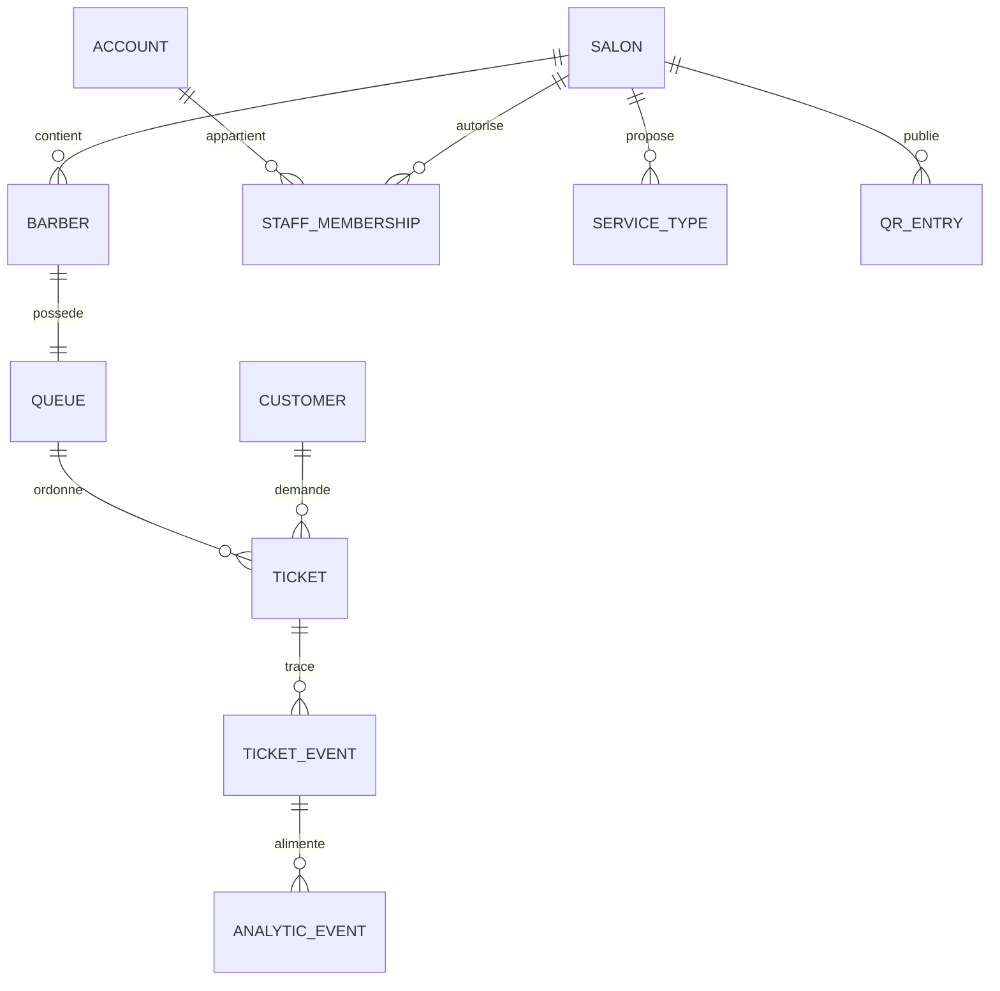

# FILA — Modèle conceptuel et proposition de schéma de données

Version 0.2 — mise à jour 22 octobre 2026 — **RÉDIGÉ — À VÉRIFIER**. Proposition logique initiale amendée par D-023..D-037. Le schéma n’est pas une migration prête à appliquer; plusieurs décisions de conception restent ouvertes.

## 1. Principes

- PostgreSQL est l’orientation de stockage; les données d’ordre/état sont autoritaires côté serveur.
- Un ticket appartient à un salon, une file/coiffeur et une référence client selon un modèle d’identité à décider.
- L’unicité du ticket actif doit être garantie par une contrainte ou transaction sérialisée, pas uniquement une vérification UI.
- Les transitions produisent des événements auditables; les agrégats analytiques sont dérivés et séparés.
- Données personnelles minimales; numéro de ticket généré par le système.

## 2. Modèle conceptuel



Relations exactes et possibilité qu’un coiffeur soit aussi compte/responsable sont à confirmer.

## 3. Entités candidates

| Table logique | Champs indicatifs | Contraintes et notes |
|---|---|---|
| `salons` | `id uuid PK`, `name`, `timezone`, `status`, `created_at` | `timezone` explicite; statut et identité commerciale à spécifier. |
| `barbers` | `id uuid PK`, `salon_id FK`, `display_name`, `status`, `specialties` | Coiffeur rattaché à un salon; spécialités structurées si utilisées en filtre. |
| `queues` | `id uuid PK`, `salon_id FK`, `barber_id FK UNIQUE`, `status`, `version` | Une file associée au coiffeur; fermeture et pause à définir. |
| `accounts` | `id uuid PK`, `auth_subject UNIQUE`, `role metadata` | Rôle effectif via memberships, pas depuis champ modifiable client. |
| `customers` | `id uuid PK`, `account_id nullable FK`, `pseudonym`, `created_at` | Liaison facultative à compte dépend de décision d’auth; attention aux clients assistés. |
| `staff_memberships` | `account_id FK`, `salon_id FK`, `barber_id nullable FK`, `role`, `active` | Clé composée/unique selon politique; rôle gérant non obligatoire. |
| `service_types` | `id uuid PK`, `salon_id FK`, `name`, `duration_hint nullable` | Type facultatif pour ticket; durée estimée à valider et ne doit pas être présentée comme garantie. |
| `tickets` | `id uuid PK`, `public_number`, `customer_id`, `queue_id`, `service_type_id nullable`, `source`, `status`, `created_at`, `called_at`, `started_at`, `finished_at`, `version` | `public_number` unique dans portée choisie; transitions serveur uniquement; statut terminal à fixer. |
| `ticket_events` | `id uuid PK`, `ticket_id FK`, `actor_id nullable`, `event_type`, `from_status`, `to_status`, `occurred_at`, `metadata_minimal` | Append-only recommandé; données personnelles interdites dans metadata sans besoin démontré. |
| `qr_entries` | `id uuid PK`, `salon_id FK`, `barber_id nullable FK`, `token_hash`, `active`, `created_at`, `revoked_at` | Stocker hash du jeton; contenu public opaque; rotation/révocation. |
| `analytic_events` | `id uuid PK`, `salon_id`, `barber_id`, `ticket_id nullable`, `event_type`, `occurred_at`, `source`, `schema_version` | Limiter identifiants; rétention et agrégations à fixer. |

Cette liste est candidate. Ne pas ajouter tables `analytics` ou `queue_positions` si le calcul transactionnel peut être représenté plus simplement; valider modèle par invariants et charge attendue.

## 4. Unicité des tickets actifs

Le concept PostgreSQL de contrainte unique partielle peut représenter « au plus un ticket actif par client » si l’identité client est fiable et si les états terminaux sont définis. Exemple illustratif non exécutable avant validation :

```sql
-- Schéma conceptuel uniquement : adapter états et clé client avant migration.
CREATE UNIQUE INDEX one_active_ticket_per_customer
ON tickets (customer_id)
WHERE status IN ('waiting', 'called', 'in_service');
```

Deux réserves importantes :

1. `customer_id` doit correspondre au même utilisateur dans les parcours mobile, QR et ajout assisté; un profil créé ad hoc par le personnel ne garantit rien sans mécanisme de rapprochement.
2. L’ensemble des statuts actifs doit inclure tout état qui empêche une nouvelle inscription. Une absence temporaire peut rester active ou devenir terminale selon décision métier.

L’ordre de file peut être un numéro monotone transactionnel par queue ou un ordre dérivé des événements, mais il faut éviter les rangs qui se dupliquent sous concurrence et gérer annulation/réinsertion. Le choix est à faire dans le composant Queue Engine.

## 5. Index proposés à évaluer

- `tickets(queue_id, status, created_at)` pour consulter file active;
- unique partiel sur `tickets(customer_id)` pour états actifs, si modèle d’identité validé;
- unique sur portée du numéro public (`salon_id`, numéro ou préfixe de journée selon décision);
- `ticket_events(ticket_id, occurred_at)`;
- `analytic_events(salon_id, occurred_at, event_type)`;
- indexes FK et memberships pour vérification des permissions.

Les index exacts dépendent des requêtes et volume mesurés; éviter les index redondants et mesurer leurs coûts d’écriture.

## 6. RLS / permissions — politique attendue

- Client : lecture de son ticket et profil lié uniquement; aucune écriture directe de statut/rang.
- Coiffeur : lecture et transitions permises pour les files explicitement rattachées à son membership actif; ajout assisté via fonction contrôlée.
- Responsable : configuration salons/QR et agrégats du salon selon rôle confirmé; ne pas confondre administration et visibilité de données clients.
- Service : droits minimaux nécessaires; opérations privilégiées encapsulées et auditées.
- Accès refusé par défaut et tests inter-salon obligatoires.

Le langage de politiques doit être adapté à la solution choisie; aucune politique RLS finale n’est fournie avant validation des rôles et des mécanismes d’identité.

## 7. Migrations, test data et opérations

- Chaque migration est versionnée, relue et accompagnée de tests d’intégrité/RLS.
- Environnements isolés et jeux synthétiques; ne pas copier données clients réelles vers développement.
- Les jeux de test couvrent deux salons, plusieurs coiffeurs, identité client mobile/assistée, tickets actifs et terminaux, événements manquants, demandes simultanées et QR révoqué.
- Planifier sauvegarde et restauration; test de restauration avant pilote.
- Toute évolution de statut doit mettre à jour les formules analytiques et tests de transition.

## 8. Décisions requises avant DDL final

- Identité commune qui permet l’unicité sans exclure le client assisté.
- Association coiffeur/compte et cumul des rôles.
- États actifs/terminaux et traitement de l’absence.
- Portée et format du numéro de ticket.
- Règles de position après annulation/changement de coiffeur.
- Données personnelles, conservation, suppression et audit.
- Choix final du backend, de l’authentification et des politiques de sécurité.

## 9. Décisions de données intégrées — 22 octobre 2026

Source SRC-008 / D-023..D-037. Ces compléments précisent le modèle candidat sans constituer un DDL prêt à appliquer.

### Portée des identités

- `customers.account_id` relie un compte authentifié avec numéro vérifié, reconnu entre salons.
- Prévoir une entité/association de profil client salon-only (nom/pseudonyme minimal, `salon_id`, date de création), utilisable sans téléphone et sans compte. Aucune reconnaissance entre salons n’est garantie pour cette fiche.
- Un profil d’affichage enfant est géré par l’adulte; aucun compte enfant ni numéro/date de naissance enfant.
- Unicité du ticket actif : au niveau compte global pour un compte vérifié; au niveau de la fiche dans le même salon pour un profil assisté. Ne pas prétendre empêcher une autre file dans un autre salon pour un profil salon-only.
- OTP et état de session appartiennent au service d’authentification retenu; ne jamais persister un code en clair.

### File et affectation

`queues` doit porter un statut manuel individuel par coiffeur et une trace de fermeture effective/auteur. Les horaires planifiés sont informatifs, sans trigger ni blocage automatique. Pour « premier disponible », conserver l’instant de dernière attribution par coiffeur; calculer les clients devant selon les états métier et sous contrôle transactionnel. L’aptitude prestation et l’acceptation de nouveaux tickets doivent être modélisées séparément de la vitesse estimée. La vitesse n’influence pas l’affectation.

### Remplacement inter-salon

Pour un compte global avec un ticket actif ailleurs, créer le nouveau ticket avec succès avant annulation de l’ancien; échec = ancien inchangé. Le mécanisme (transaction commune ou réservation temporaire contrôlée) doit assurer qu’aucun état double actif durable n’est visible. À confirmer dans une ADR; ne pas utiliser le parcours salon-only pour prétendre à une détection inter-salon.

### États et événements

États candidats V1 : `waiting`, `called`, `in_service`, `completed`, `cancelled`, `no_show`, `expired`. Aucun délai d’absence : le coiffeur peut marquer absent seulement après appel. Fermeture effective : attente, absence, appel sans prestation commencée expirent; `in_service` continue. Réactivation le même jour avant fermeture par le coiffeur responsable, après contrôles et acceptation de justification, reprend la position d’origine. Action/auteur historisés sans détail sensible. Le ticket expiré ne revient pas le lendemain.

Les événements ticket V1 sont opérationnels uniquement; Analytics Engine, statistiques, agrégats et tableaux de bord sont V2. L’entité `analytic_events` est donc hors du schéma V1; ne garder qu’un journal d’événements de ticket minimal.

### Historique et conservation

Tickets terminés, annulés ou expirés disparaissent de la liste active. Historique client 30 jours; opérations salon 90 jours; historique à la demande, limité et paginé. Au-delà, supprimer ou anonymiser les données identifiantes après validation juridique des obligations applicables avant essais réels/lancement. Cette durée est un cadrage du fondateur, pas une preuve de conformité.

### Connexion et notifications

Toute mutation passe par un serveur joignable et doit être confirmée. Pas de file d’écritures hors ligne ni de fusion de conflits en V1. Hors connexion, lecture marquée périmée et rafraîchie à la reconnexion. Les notifications ticket V1 couvrent uniquement création confirmée, approche, appel, annulation et expiration; elles ne pilotent pas l’ordre. Promotion et événements statistiques sont reportés.

### À résoudre avant DDL final

Représentation des profils salon-only et lien facultatif vers compte; portée d’unicité pour profil assisté; fournisseur OTP et session; définition calculable des clients devant; transaction de remplacement; réouverture d’une file après fermeture; conservation et anonymisation après avis juridique; sécurisation du QR et journalisation minimale. Aucun DDL n’a été appliqué.

