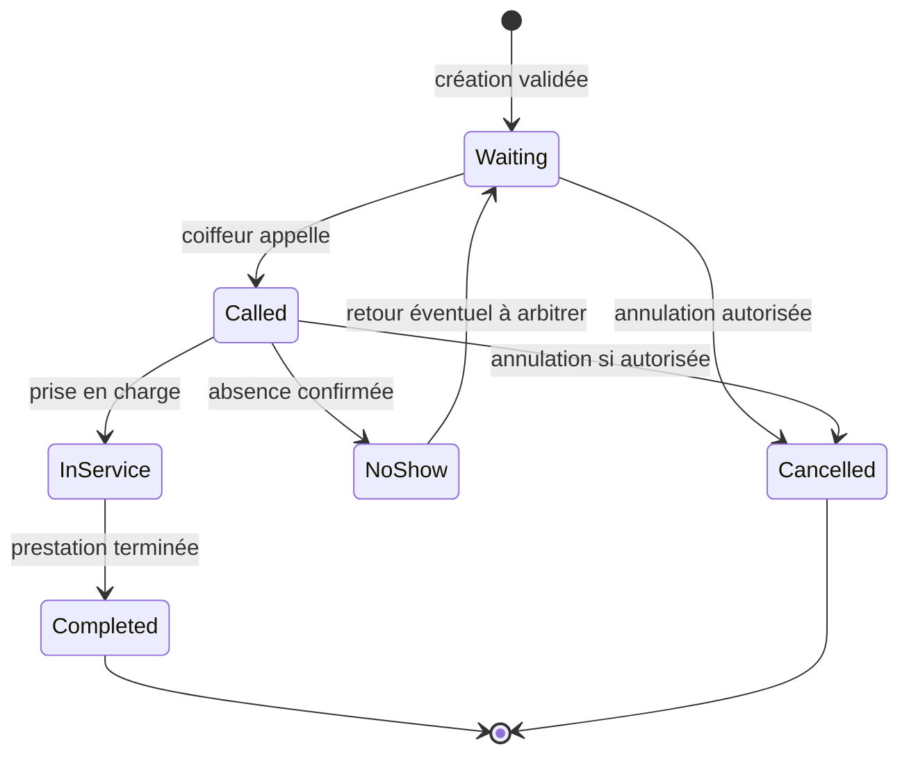

# FILA — Queue Engine et Analytics Engine

Version 0.2 — mise à jour 22 octobre 2026 — **RÉDIGÉ — À VÉRIFIER**

## 1. Frontière de responsabilité

Le Queue Engine est l’autorité pour créer, attribuer, ordonner et faire évoluer les tickets. En V1 il écrit seulement les événements opérationnels nécessaires aux tickets. Analytics Engine, statistiques et tableaux de bord sont reportés à V2 et ne commandent jamais la file (D-033, D-017).

```mermaid
sequenceDiagram
  participant C as Client ou coiffeur
  participant API as API sécurisée
  participant Q as Queue Engine
  participant DB as PostgreSQL
  participant A as Journal opérationnel V1
  C->>API: Demande créer ticket + clé idempotente
  API->>Q: Valider identité, salon et règles
  Q->>DB: Transaction: contrôler actif, attribuer et créer événements
  DB-->>Q: Ticket unique confirmé ou conflit
  Q-->>API: Résultat autoritaire
  API-->>C: Confirmation ou erreur compréhensible
  DB-->>A: Événement opérationnel ticket
  Note over A: Aucun calcul analytique V1; Analytics V2
```

## 2. Queue Engine — commandes et invariants

Commandes conceptuelles : `CreateTicket`, `CallNext`, `MarkAbsent`, `StartService`, `CompleteService`, `CancelTicket`, `CorrectAction`, `ChangeBarber`. Les commandes non décidées restent hors contrat final tant que leurs règles ne sont pas approuvées.

Invariants confirmés ou directement nécessaires à D-005/D-010 :

1. Un seul ticket actif par utilisateur reconnu par le système.
2. Ticket lié à une seule file/coiffeur et à un seul salon valide.
3. Une position active n’est jamais attribuée simultanément à deux tickets de la même file.
4. Seul le serveur autorisé confirme la création ou transition.
5. Le même canal ou une répétition réseau ne peut créer deux tickets à partir d’une seule intention reconnue.
6. Toute entrée de canal traverse les mêmes contrôles.
7. L’analytics ne participe pas à la décision de rang.

### Traitement d’une création concurrente

1. Authentifier ou établir la preuve d’identité selon le parcours retenu.
2. Autoriser l’accès au salon et vérifier que la file accepte l’entrée.
3. Ouvrir une transaction; contrôler le ticket actif et le choix de coiffeur.
4. Réserver un numéro/rang cohérent et créer ticket + événement dans la transaction.
5. Commit; produire un résultat déterministe.
6. Si conflit de ticket, renvoyer le ticket existant et le parcours de résolution; ne pas créer un ticket secondaire.
7. Publier les événements durables vers analytics après commit (transactional outbox ou mécanisme équivalent à évaluer).

Le verrouillage, niveau d’isolation et mécanisme de file exacts seront décidés après le schéma et tests de concurrence. Une simple vérification applicative avant insert n’est pas suffisante.

## 3. Machine à états — proposition minimale à arbitrer



Les états proposés ne sont pas encore décision métier. Il faut choisir si `NoShow` reste actif, quel délai/combien d’appels, qui peut annuler, si annulation après appel est permise, et si correction d’erreur restaure l’état ou produit un événement compensatoire.

## 4. Affectation « premier disponible »

Règle confirmée : l’option existe; vitesse et spécialités doivent pouvoir être prises en compte dans la conception. Algorithme à arbitrer. Critères candidats : disponibilité explicitement déclarée; spécialité compatible; charge estimée ou temps restant; stabilité de l’affectation; égalité résolue de façon reproductible; possibilité pour le client de refuser la suggestion. Aucune combinaison ni priorité n’est adoptée dans ce document.

La disponibilité doit être distincte de l’estimation de durée. Une prédiction de durée ne peut être présentée comme garantie ni réordonner une file sans décision explicite.

## 5. Récupération et erreurs

| Situation | Réponse attendue |
|---|---|
| Ticket actif déjà existant | Aucun ticket supplémentaire; indiquer la situation active et proposer uniquement les résolutions autorisées. |
| Réponse serveur perdue après commit | Retry idempotent renvoie le ticket déjà créé. |
| Conflit concurrent sur même file | Une seule transaction gagne; autres reçoivent état cohérent, sans rang dupliqué. |
| Coiffeur fermé/indisponible | Refus explicite et choix alternatif selon règle approuvée; pas de transfert silencieux. |
| Réseau absent avant envoi | Afficher attente de connexion; ne pas annoncer de ticket créé. |
| Écriture réussie mais analytics indisponible | Ticket reste valide; événement est rejoué ou traité plus tard. |
| Action de coiffeur erronée | Rejeter transition non permise ou exécuter correction autorisée et historisée. |

## 6. Événements opérationnels V1 et Analytics Engine V2

| Événement | Données minimales | Usage |
|---|---|---|
| `ticket_created` | ticket pseudonymisé, salon, coiffeur, canal, heure, prestation facultative | Entrées par canal, volume. |
| `ticket_called` | ticket, salon/coiffeur, heure | Attente jusqu’à appel; nombre d’appels à préciser. |
| `service_started` | ticket, heure | Durée avant prestation, occupation. |
| `service_completed` | ticket, heure | Clients servis, durée de prestation. |
| `ticket_cancelled` | ticket, acteur/canal, heure, motif si nécessaire | Annulations, sans conserver motif sensible par défaut. |
| `ticket_no_show` | ticket, heure | Absences selon définition métier. |
| `ticket_reassigned` | ancienne/nouvelle file, acteur, heure | Mesurer transferts et corriger métriques. |
| `queue_paused/resumed` | salon/coiffeur, heure, acteur | Contextualiser les délais et plages actives. |

En V1, ces événements servent uniquement à gérer et historiser les tickets; aucun indicateur ou tableau de bord n’est calculé. Utiliser version de schéma et heure serveur; éviter nom/téléphone. Toute agrégation relève de V2.

## 7. Définitions métriques à adopter

| Indicateur | Définition candidate | Décisions méthodologiques restantes |
|---|---|---|
| Clients servis | Tickets atteignant `Completed` dans la fenêtre. | Compter tickets ou personnes? Exclure tickets tests et reprises? |
| Attente moyenne | Moyenne(`called_at - created_at`) ou `service_started_at - created_at`. | Choisir appel ou début réel; traitement des absents et files pausées; publier nombre d’observations. |
| Durée moyenne prestation | Moyenne(`completed_at - service_started_at`). | Exclure annulations, valeurs aberrantes et horodatages manquants. |
| Absences | Tickets marqués absence / tickets appelés. | Délai, rappels et retour éventuel. |
| Annulations | Tickets annulés par période et canal. | Dénominateur, acteur et annulations administratives. |
| Coiffeurs les plus sollicités | Tickets créés ou servis par coiffeur sur période. | Présenter les deux métriques distinctement; tenir compte des heures ouvertes. |
| Heures de pointe | Comptage de créations par heure locale du salon. | Fuseau, jours comparables et fenêtres d’ouverture. |
| Origine d’entrée | Tickets par source mobile/QR/assisté. | Définition du canal si parcours hybride. |

Chaque rapport doit afficher la fenêtre temporelle, fuseau et volume d’échantillon; une moyenne seule peut masquer dispersion et données manquantes. Toute estimation affichée au client est distincte d’un indicateur historique.

## 8. Confidentialité et exploitation

- Analytics consomme seulement les attributs nécessaires aux indicateurs.
- Restreindre l’accès aux agrégats par salon; petits volumes peuvent réidentifier indirectement une personne et nécessitent prudence.
- Définir conservation/suppression avant collecte réelle.
- Surveiller retard du pipeline, doublons d’événements, événements rejetés et dérive de schéma.
- Rejouer les événements de manière idempotente pour ne pas doubler les agrégats.
- Documenter correction/réconciliation après incident sans modifier silencieusement les événements sources.

## 9. Validation nécessaire

Arbitrer l’identité client, états, transitions, absence, annulation, premier disponible, fermeture/reprise et formules analytiques. Ensuite créer tests unitaires de transitions, tests de concurrence, tests de propriétés d’unicité, tests de panne du pipeline analytique, tests de rejeu/idempotence et tests de permissions. Aucun test n’a été exécuté dans le cadre de la rédaction présente.


## 10. Règles V1 intégrées — 22 octobre 2026

Les décisions SRC-008 / D-023..D-037 priment sur les anciennes questions et propositions de ce document.

### Identité et ticket actif

Compte avec numéro vérifié : identité réutilisable entre salons, OTP uniquement à la première inscription app/QR si session valide ensuite. Profil sans compte ou assisté : salon-only, sans reconnaissance inter-salon; profil minimal possible sans téléphone. Pour un compte global avec ticket actif ailleurs, le client choisit conserver l’ancien ou le remplacer; créer le nouveau avec succès avant annuler l’ancien, et si échec l’ancien demeure actif. Aucun double actif durable ne doit être visible. Pour salon-only, pas de garantie inter-salon.

### Affectation

Coiffeur choisi précisément : respect du choix, sans transfert silencieux. « Premier disponible » : coiffeurs qui acceptent des tickets et peuvent faire la prestation; choisir le moins de clients devant. Égalité : priorité à celui qui attend depuis le plus longtemps depuis sa dernière attribution. Vitesse ne sert qu’à l’estimation, sans effet d’affectation ni garantie de durée.

### Statuts et fermeture

Absence manuelle seulement par coiffeur et après appel; pas de timer. Horaires affichés informatifs, aucune fermeture automatique. Chaque file est fermée manuellement et indépendamment. À la fermeture effective, tickets en attente/absents/appelés non démarrés expirent; prestations en cours se poursuivent; autres coiffeurs non affectés. Client d’un coiffeur fermé choisit explicitement autre coiffeur ou retour ultérieur. Réactivation possible le même jour avant fermeture par le coiffeur responsable : action déclenche les contrôles, réussite sans deuxième confirmation; ce coiffeur juge la justification. Si acceptée, position initiale; action/auteur journalisés sans détails sensibles; pas de réactivation le lendemain.

### V1 sans Analytics Engine

V1 conserve un journal minimal d’événements opérationnels (création, appel, absence, réactivation, fin, annulation, expiration). Ce journal n’est ni analytics, ni dashboard, ni statistique et ne modifie jamais l’ordre. Le composant Analytics et les indicateurs sont V2. Les anciennes tables d’événements analytiques et définitions statistiques des sections précédentes sont V2 uniquement, non V1.

### Changement, connexion, notification et historique

Avant appel, changement demandé par le client = fin de la file du nouveau coiffeur; après appel = demande explicite au coiffeur, action retenue par lui. Toute écriture V1 nécessite Internet et confirmation serveur. Hors connexion, état possiblement ancien clairement indiqué et écriture interdite; à reconnexion, actualiser lecture. Panne individuelle n’empêche pas les autres en ligne; panne serveur = échec explicite. Notifications ticket limitées à création confirmée, approche, appel, annulation, expiration. Pas de paiement client pour ticket en V1; prix salon ouvert. Historique client 30 jours et salon 90 jours, à la demande/paginé; suppression/anonymisation après délai sous réserve de validation juridique avant essais/lancement.

